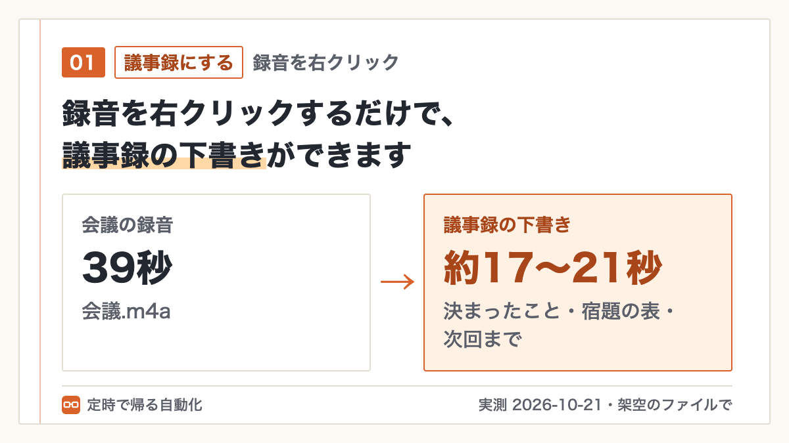

# 右クリックで事務

ファイルを右クリックして1回選ぶだけで、議事録の下書き・PDFの名前付け・写真の縮小が済む道具です（Mac）。

## できること

Finderでファイルを右クリック →「クイックアクション」に、次の5つが出ます。

| メニュー | 右クリックするファイル | できる物 | 外に送るか |
|---|---|---|---|
| 議事録にする（Claude） | 録音・録画（m4a・mp3・mp4など）、メモ（.txt）、Zoom・Teamsの字幕（.vtt） | `元の名前_議事録.md` | 文字起こしはパソコンの中。文字だけClaude Codeへ |
| 文字起こしだけ（パソコンの中だけ） | 録音・録画 | `元の名前_文字起こし.txt` | 送らない |
| 中身から名前を付ける（Claude） | PDF | `20261015_株式会社みどり文具_請求書_68,200円.pdf` のような名前の案 | 最初の3ページの文字だけClaude Codeへ |
| 申請用に小さくする | 写真（jpg・png・iPhoneのHEIC） | `元の名前_500KB以下.jpg` | 送らない |
| 位置情報を消す | 写真（iPhoneのHEICも） | `元の名前_位置情報なし.jpg`（撮った日時は残る） | 送らない |

- 元のファイルは上書きしません。名前を付けるときだけ、案を見せて「変える」を押したときに変えます
- Claude Code が無いMacでも5つとも動きます。議事録は「頼み方＋文字起こし」の文がコピーされるので、ChatGPTなどに貼ってください。名前付けは、日付・会社名・書類の種類・金額を書類によくある形から拾います

## 試した結果（実測）

| 右クリックしたファイル | できた物 | かかった時間 |
|---|---|---|
| 39秒の会議の録音 | 決まったこと・宿題（誰が・何を・いつまで）に分かれた議事録の下書き | 約17〜21秒（3回） |
| 6行の会議メモ | 同じ形の議事録。「保留」と書いた件は「決まらなかったこと」に分かれた | 約8〜11秒（3回） |
| `scan_0012.pdf`（架空の請求書） | `20261015_株式会社みどり文具_請求書_68,200円.pdf` の案 | 約5〜9秒 |
| 約12MBの写真（4000×3000） | 409KBのJPG | 約5秒（3回） |
| 位置情報つきの写真 | 位置情報だけ消えた写真 | 1秒かからず（3回） |

測った日：2026年10月21日／Mac（macOS 26.5）／試したのは `試しのファイル/` に入っている架空のファイルです。

## 入れ方

1. [Releases](https://github.com/zuborakakaricho-cmyk/migiclick/releases) から `migiclick-mac-v0.1.zip` をダウンロードして開く
2. 中の「Macに入れる.command」をダブルクリック（必要なものを自動で取ってきます。数分かかります）
3. 「入れ終わりました」と出たら完了です

管理者のパスワードは要りません。入れる場所はあなたのユーザーの中（`~/Library/Application Support/migiclick`）です。外すときは「Macから外す.command」をダブルクリックします。

**「開けません」と止められたとき**：「完了」で閉じてから、システム設定 →「プライバシーとセキュリティ」を下までスクロールし、「このまま開く」を押してください。ネットから落としたファイルなので、初回だけMacが止めます。

ターミナルを使う人は、`git clone` してから `python3 mac/install.py`（外すときは `--remove`）でも入れられます。

## 使い方

`試しのファイル/会議.m4a` を右クリック →「クイックアクション」→「議事録にする（Claude）」。終わると通知が出て、Finderで `会議_議事録.md` が選ばれた状態で開きます。

## 確かめた環境

| | |
|---|---|
| 確かめた日 | 2026年10月21日 |
| パソコン | Mac（macOS 26.5） |
| Windows | 未確認（Windows版は準備中です） |

## できないこと・注意

- 「（Claude）」と付いた2つは、文字（文字起こし・PDFの最初の3ページの文字）を Claude Code に渡します。社外秘の書類で使ってよいかは、会社の決まりを確かめてください
- 文字起こしは、いちばん軽いモデル（base）を使っています。名前や専門用語は聞き違えます（例：「チラシ」→「知らし」）。金額・日付・名前は、必ず録音と照らし合わせてください。精度を上げるなら `config.json` の `whisper_model` を `small` にします（遅くなります）
- 名前付けがうまくいくのは、日付・会社名・金額が文字として入っているPDFです。写真だけのスキャン（文字を選べないPDF）からは拾えません
- 会社のパソコンには、自分でソフトを入れられないことがあります。入れる前に情報システムの担当に確かめてください

## うまくいかないとき

| 出たもの | 原因 | 直し方 |
|---|---|---|
| 右クリックに「クイックアクション」が出ない | 入れたあと、Finderがメニューを読み直していない | Finderを開き直す（⌥を押しながらDockのFinderを右クリック →「再度開く」）。それでも出なければ Issues で教えてください |
| 「“Macに入れる.command”は開いていません」 | ネットから落としたファイルを、Macが初回だけ止めた | 上の「開けません」と止められたとき を参照 |
| 議事録ではなく「頼み方」がコピーされた | Claude Code が無いか、返事が5分で来なかった | ChatGPTなどに貼る。Claude Code を使うなら、ターミナルで `claude` が動くか確かめる |
| 要るものがそろっているか知りたい | ― | `python3 migiclick.py doctor` で、機能ごとに○✕が出る |

## 作った人

ズボラ係長（ブログ：https://teiji-jidouka.com/ ／X：https://x.com/zubora_kakari ）。不具合や要望は Issues へどうぞ。

ライセンス：MIT
